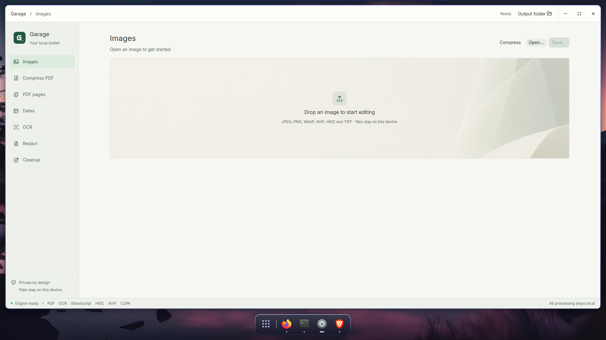

# Garage

A local-first desktop toolkit for the documents you would rather not upload.



Garage is a native Rust window (GPUI) talking to a Python engine over a pipe.
There is no server, no account, no telemetry, and no network calls. If the app
is running, it works on a plane.

## What it does

| Tool | What happens |
| --- | --- |
| **Images** | A compact toolbar crops, rotates, flips, resizes, or converts to black and white, with a live edited preview and a Save button. Crop directly on the image and compare with the original. Batch compress JPEG/PNG/WebP/AVIF/HEIC with email/web presets or a target file size. EXIF, GPS, and camera metadata are stripped by default. |
| **Compress PDF** | Downsamples the images inside a PDF, rewrites them, cleans the object graph, and can run a Ghostscript pass. Text stays text. |
| **AI signals** | Reads generator tags and prompts embedded in images, then verifies any C2PA Content Credentials signature locally. No verdict, no network — absence of metadata is reported as unknown, never as "human". |
| **Redact** | Draw boxes directly on an image or PDF preview. Browse PDF pages, undo areas, compare the original with a live redacted preview, and export a copy. Images support pixelate, blur, or solid black. PDFs are flattened so hidden text and metadata are gone. |
| **PDF pages** | Merge, split by page count, or extract page ranges. |
| **Dates** | Bikram Sambat ↔ Gregorian conversion with a real month-length table (BS 1975–2100), Nepali or Latin digits, and a clickable month calendar. |
| **OCR** | Extract text from scans, add an invisible selectable text layer to a scanned PDF, or scan for dates and read them in both calendars. Tesseract runs locally. |
| **Cleanup** | Deskew, denoise, threshold, and autocrop phone photos of documents. Compare the original with a live cleaned preview before saving. Keep threshold off for signatures. |

Every operation writes a new file. Garage never overwrites its input.

## Privacy model

- The engine is a child process. Rust writes one JSON request per line to its
  stdin and reads events from its stdout. No socket is opened.
- `engine/garage_engine` contains no HTTP client and no analytics.
- Metadata is removed before compressed images are written.
- C2PA verification uses the official local SDK. It checks signature integrity only; trust anchors are not fetched, so Garage does not claim a signer is trusted.
- The only optional external programs are `tesseract` (OCR) and `gs`
  (Ghostscript). Both are local command-line tools; Garage reports them as
  missing instead of downloading anything.

## Build

Requirements: Rust 1.85+, Python 3.11+, and the usual GPUI Linux
dependencies (Vulkan, Wayland/X11, fontconfig).

```bash
./scripts/install.sh
```

That creates `.venv`, builds the PyInstaller sidecar, builds the release
binary, and installs `garage`, `garage-engine`, the desktop entry, and the icon
into `~/.local`.

Development, with instant Python edits:

```bash
python3 -m venv .venv
.venv/bin/pip install -e engine
cargo run
```

The app looks for the engine in this order: `GARAGE_ENGINE`, a sibling
`garage-engine` binary, the project `.venv`, then `uv`.

Optional: `tesseract` for OCR (plus `tesseract-data-nep` for Nepali) and `gs`
for the Ghostscript compression pass.

### Portable Linux builds

```bash
./scripts/build-linux.sh
```

This creates `dist/Garage-0.1.0-x86_64.AppImage`, a portable `.tar.gz`,
`dist/garage`, and the frozen `dist/garage-engine`. Keep the two executables
together when using the bare binary. The AppImage includes both.

Packaging needs a type-2 AppImage runtime and `mksquashfs`. Set
`APPIMAGE_RUNTIME` and `MKSQUASHFS` to their paths; the script also finds
the cached electron-builder AppImage tools when available. To package an
existing build without recompiling, run `.venv/bin/python scripts/package-linux.py`.

Run the AppImage with `chmod +x Garage-*.AppImage` then `./Garage-*.AppImage`.
Without FUSE, use `./Garage-*.AppImage --appimage-extract` and run
`squashfs-root/AppRun`. The package's `build-info.json` records the minimum
glibc version required by its build host. For wider Linux compatibility,
build on the oldest distribution you support. A desktop graphics driver is
still required; OCR and Ghostscript remain optional system tools.

### Windows executable

Build on Windows x86_64 with Rust's MSVC toolchain, Python 3.12+, and the
Visual Studio C++ Build Tools/Windows SDK. From a developer PowerShell:

```powershell
./scripts/build-windows.ps1
```

The portable ZIP in `dist` contains `Garage.exe` and `garage-engine.exe`.
Keep them together after extraction. No separate Python installation is needed
to run it. The **Build and release** GitHub Actions workflow builds both platforms
and uploads downloadable packages as build artifacts.
The Windows build has to run on Windows because the Python sidecar is frozen
for the host platform.

For a headless packaged-engine check, run `garage --check-engine` on Linux.
Both platforms also accept `--version`.

### GitHub releases

The workflow in `.github/workflows/release.yml` builds Linux x86_64 on Ubuntu
24.04 and Windows x86_64 on Windows Server 2022. Pull requests, pushes to `main`,
and manual runs test and package both platforms without publishing a release.
Use **Actions → Build and release → Run workflow** to try a build first.

To publish a release:

1. Set the same version in `Cargo.toml`, `engine/pyproject.toml`, and the
   `VERSION` constant in `engine/garage_engine/main.py`.
2. Commit and push the changes, including the workflow and test fixture.
3. Tag that commit and push the tag (replace the example version as needed):

   ```bash
   git tag v0.1.0
   git push origin v0.1.0
   ```

The tag must be `vMAJOR.MINOR.PATCH` and match all three version values. Both
builds must pass Rust tests and checks of their extracted packages before
publishing. The release contains the AppImage, Linux portable `.tar.gz`,
Windows portable ZIP, and a combined `SHA256SUMS` file. GitHub also provides
source archives for the tagged commit.

No personal access token or repository secret needs to be created. GitHub
provides `GITHUB_TOKEN` automatically; only the publishing job requests
`contents: write`. Repository or organization policies must allow Actions and
that permission. The job stages all downloads in a draft release and publishes
only after upload succeeds. Reruns can finish a draft; already published
releases are preserved. Use a new version tag for replacement builds.

The CI AppImage is built against Ubuntu 24.04; see its `build-info.json` for
the actual minimum glibc requirement. A working graphics driver is required.
Windows packages are unsigned portable ZIPs, not installers. OCR and
Ghostscript remain optional system tools on both platforms.

## Layout

```
src/                 Rust UI
  main.rs            window, sidebar, status bar, engine event pump
  engine.rs          sidecar supervisor (stdin/stdout JSON lines)
  jobs.rs            job board shared by every view
  bs/                Bikram Sambat calendar and tests
  views/             one module per tool
engine/              Python engine
  garage_engine/     img, pdf, ocr, cleanup, protocol
tests/               end-to-end smoke tests and fixtures
scripts/install.sh   build + install
```

## Tests

```bash
cargo test
PYTHONPATH=engine .venv/bin/python tests/smoke.py
```

The calendar tests round-trip every day from BS 1975-01-01 to 2100-12-30
against a fixture of anchor dates.

## License

AGPL-3.0-or-later. PyMuPDF, used by the engine, is AGPL-3.0.
